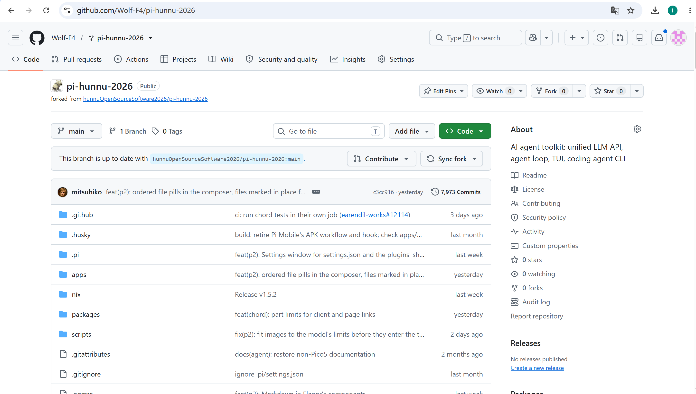
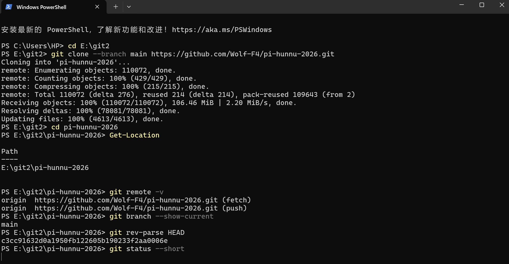
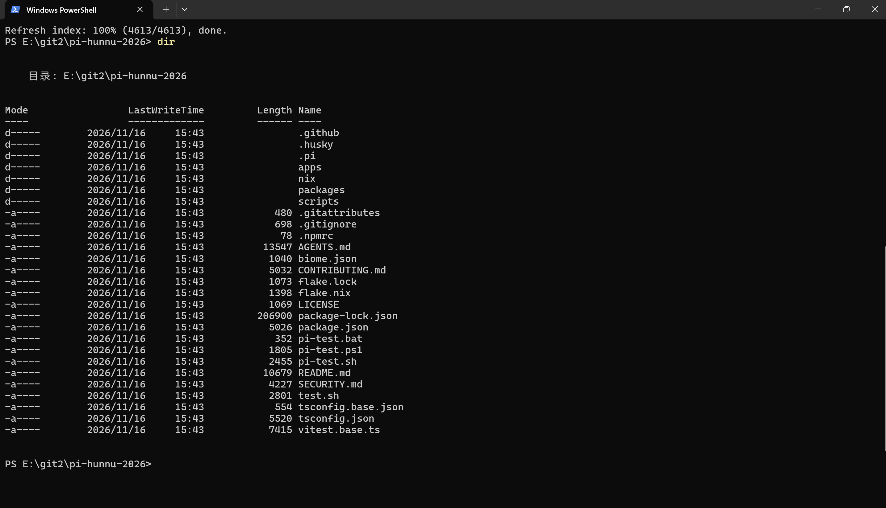
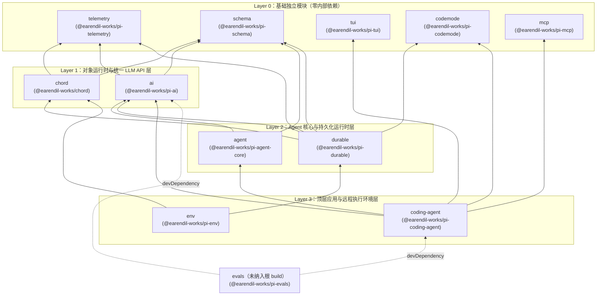
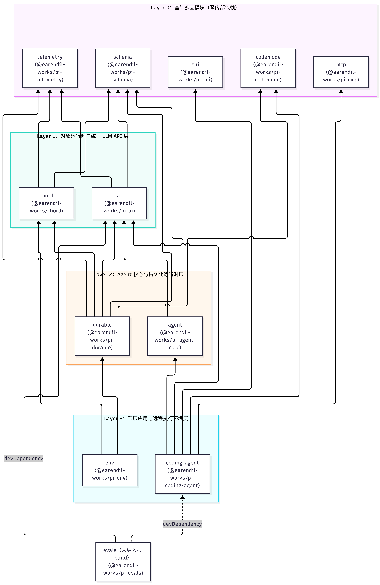

# 实践课2：小组组织建仓与 Pi Agent 源码分析

- **姓名 / 学号**：曹紫欣 202430224047
- **所在小组 Organization**：`Wolf-F4`
- **小组仓库地址**：https://github.com/Wolf-F4/pi-hunnu-2026
- **实际 Clone 地址**：`https://github.com/Wolf-F4/pi-hunnu-2026.git`
- **本地检出提交编号（HEAD）**：`c3cc91632d0a1950fb122605b190233f2aa0006e`

---

## 一、源码获取

### 1. 小组组织仓库 Fork 验证

小组长已将教师课程仓库 `hunnuOpenSourceSoftware2026/pi-hunnu-2026` Fork 至小组 Organization `Wolf-F4`（仓库地址：`https://github.com/Wolf-F4/pi-hunnu-2026`），且已确认成员具备仓库访问权限。



### 2. 本地 Clone 与版本核对（截图 S1）

在纯英文路径下执行以下操作并核验仓库来源与分支状态：

```powershell
git clone --branch main https://github.com/Wolf-F4/pi-hunnu-2026.git
cd pi-hunnu-2026
Get-Location
git remote -v
git branch --show-current
git rev-parse HEAD
git status --short
```



### 3. 本地源码目录结构



---

## 二、模块分析

### 1. 构建顺序与目录结构差异说明

查看根目录 `package.json` 的 `scripts.build`，实际串行构建以下 **11 个子模块**，构建顺序为：

`telemetry` → `schema` → `chord` → `tui` → `codemode` → `mcp` → `ai` → `durable` → `env` → `agent` → `coding-agent`

**目录增减差异说明**：
- 对比任务表列出的 11 个文件夹，仓库的 `packages/` 下还存在 `evals`（`@earendil-works/pi-evals`，私有评估测试包，通过 `devDependencies` 依赖 `pi-ai` 与 `pi-coding-agent`），但它未纳入根目录 `npm run build` 流程。
- 仓库根目录下另包含 `apps/`（如 `p2`、`p2-mac`、`p3`），也不在根 `npm run build` 的构建链中。

### 2. 子模块功能与依赖分析表

| 子文件夹 | 代码主要实现什么功能 | 本模块 `build` 执行什么、生成什么 | 直接依赖哪些内部模块 | 依据文件或代码位置 |
|---|---|---|---|---|
| `telemetry` | 厂商中立的遥测契约与类型化 schema 工具：定义回调式 `TelemetryContext` / `TelemetrySpan`、`NOOP_TELEMETRY_CONTEXT`、跨进程传播载体 `TelemetryCarrier`、指标定义（Counter/Histogram）、内存参考实现 `InMemoryTelemetryContext` 及一致性测试，不绑定特定后端导出器。 | 执行 `tsc -p tsconfig.build.json`，将 `src/**/*.ts` 编译输出到 `dist/`（生成 `.js`、`.d.ts` 及 `.map`，包含 `index.js`、`render.js`、`testing/index.js`）。 | 无 | `packages/telemetry/package.json`<br>`packages/telemetry/tsconfig.build.json`<br>`packages/telemetry/README.md`<br>`packages/telemetry/src/index.ts`<br>`packages/telemetry/src/memory.ts` |
| `schema` | 无 `eval` 的 JSON Schema 构建器与校验器（支持 Draft 2020-12 与 Draft 7，兼容严格 CSP）。将 Schema 一次编译为纯闭包函数，提供类型收窄校验与 JSON Pointer 路径报错，以及基础构建器与可选 `formats` 扩展。 | 执行 `tsc -p tsconfig.build.json`，编译 `src/**/*.ts` 到 `dist/`（生成 `index.js`、`formats/index.js` 及其 `.d.ts` 与 map）。 | 无 | `packages/schema/package.json`<br>`packages/schema/tsconfig.build.json`<br>`packages/schema/README.md`<br>`packages/schema/src/index.ts`<br>`packages/schema/src/builders.ts`<br>`packages/schema/src/compiler.ts` |
| `chord` | 跨进程（服务端、Worker、浏览器）应用的对象运行时：提供契约（Contracts）、文档事务与存储（Documents / SQLite Store）、增量同步（delta）、派生状态、作业调度、通信链路（memory/IPC/WS `link`）、插件热重载以及 HTTP/Worker/Web/React/TUI 表面能力。 | 执行 `tsc -p tsconfig.build.json`，编译 `src/**/*.ts` 到 `dist/`，生成根入口与二十余个子路径入口的 `.js`、`.d.ts` 与 map。 | `schema` (`@earendil-works/pi-schema`)<br>`telemetry` (`@earendil-works/pi-telemetry`)<br>（`peerDependencies` 为可选外部包，非内部模块） | `packages/chord/package.json`<br>`packages/chord/tsconfig.build.json`<br>`packages/chord/README.md`<br>`packages/chord/src/contracts/schema.ts`<br>`packages/chord/src/data/validator.ts`<br>`packages/chord/src/telemetry.ts` |
| `tui` | 终端用户界面（TUI）库：支持主屏与备选屏渲染、差分渲染及 CSI 2026 同步输出防闪烁，内置 `Editor`、`Markdown`、`SelectList`、`ScrollView`、`Image` 等组件、按键/自动补全与终端图像协议，并附带可选跨平台原生模块源码。 | 默认 `build` 执行 `tsc -p tsconfig.build.json`，编译 `src/**/*` 生成 `dist/` 下的 `.js`、`.d.ts` 与 map（另有 `build:native:*` 脚本编译 `native/` 原生模块）。 | 无 | `packages/tui/package.json`<br>`packages/tui/tsconfig.build.json`<br>`packages/tui/README.md`<br>`packages/tui/src/index.ts`<br>`packages/tui/src/tui.ts`<br>`packages/tui/src/components/editor.ts` |
| `codemode` | 基于 QuickJS-WASM（`quickjs-wasi`）的受限 JS 沙箱：让模型编写的脚本仅能调用显式注入的工具，隔离宿主环境与上下文。提供 Node/Bun 工作线程沙箱、内联沙箱、Cloudflare 远程沙箱及工具类型声明生成器。 | 执行 `tsc -p tsconfig.build.json`，编译 `src/**/*.ts`（含 `src/cloudflare-modules.d.ts`）到 `dist/`，生成主入口及 `declarations`、`portable`、`cloudflare`、`runtime/worker` 等产物。 | 无 | `packages/codemode/package.json`<br>`packages/codemode/tsconfig.build.json`<br>`packages/codemode/README.md`<br>`packages/codemode/src/index.ts`<br>`packages/codemode/src/runtime/host.ts`<br>`packages/codemode/src/declarations.ts` |
| `mcp` | 独立轻量级 MCP（Model Context Protocol）客户端：实现传输无关的 `McpClient` 核心，内置 `StdioTransport`、`StreamableHttpTransport`、`PipeTransport`、OAuth 认证流程（`./oauth`）与内存测试传输（`./testing`）。 | 执行 `tsc -p tsconfig.build.json`，编译 `src/**/*.ts` 到 `dist/`，生成 `index.js`、`oauth/index.js`、`testing/index.js` 等及 `.d.ts`。 | 无 | `packages/mcp/package.json`<br>`packages/mcp/tsconfig.build.json`<br>`packages/mcp/README.md`<br>`packages/mcp/src/index.ts`<br>`packages/mcp/src/client.ts`<br>`packages/mcp/src/transports/pipe.ts` |
| `ai` | 统一多厂商 LLM API 层：封装 OpenAI、Anthropic、Google、Bedrock、Mistral 等接口，提供流式/非流式调用、模型目录生成与查询、OAuth/API Key 鉴权、Token 与费用统计、参数校验、图像生成/分类及遥测埋点。 | 1. 运行 `generate-models`（联网抓取上游目录，生成 `src/providers/data/*.json` 与 `*.models.ts`/`models.generated.ts`）；<br>2. 运行 `build:offline`：校验模型数据、用 `tsc -p tsconfig.build.json`（覆写 `NodeNext`）编译到 `dist/`，并复制 `src/providers/data` 到 `dist/providers/`。 | `schema` (`@earendil-works/pi-schema`)<br>`telemetry` (`@earendil-works/pi-telemetry`) | `packages/ai/package.json`<br>`packages/ai/tsconfig.build.json`<br>`packages/ai/catalog/README.md`<br>`packages/ai/src/utils/validation.ts`<br>`packages/ai/src/telemetry.ts`<br>`packages/ai/src/types.ts` |
| `durable` | 持久化（Durable）的对话、任务与文档运行时：事务性持久化对话记录、模型轮次与工具状态（Memory / IndexedDB / JSONL / SQLite），支持崩溃恢复、上下文压缩、任务图、内置文件/bash 工具、`ExecutionEnv` 抽象及 `codemode` 集成。 | 执行 `tsc -p tsconfig.build.json`，通过 `paths` 解析 `../chord/dist/` 与 `../ai/dist/` 的 `.d.ts`，编译 `src/**/*.ts`（含 `src/images/photon-wasm.d.ts`）到 `dist/`。 | `chord` (`@earendil-works/chord`)<br>`ai` (`@earendil-works/pi-ai`)<br>`codemode` (`@earendil-works/pi-codemode`)<br>`schema` (`@earendil-works/pi-schema`)<br>`telemetry` (`@earendil-works/pi-telemetry`) | `packages/durable/package.json`<br>`packages/durable/tsconfig.build.json`<br>`packages/durable/README.md`<br>`packages/durable/src/types.ts`<br>`packages/durable/src/harness/harness.ts`<br>`packages/durable/src/tools/read.ts`<br>`packages/durable/src/codemode/codemode.ts` |
| `env` | 为 Pi Durable 提供远程执行环境：通过 `BatchMode` SSH 检测平台、校验 SHA-256 并部署远端 Rust 守护进程 `pi-env`（`daemon/`），实现 `RemoteExecutionEnv`、远程进程/终端/文件监听，并提供 `LocalExecutionEnv`。 | 默认 `build` 执行 `tsc -p tsconfig.build.json`，通过 `paths` 解析 `../chord/dist/context/index.d.ts` 与 `../durable/dist/env/index.d.ts`，编译到 `dist/`（另有 `build:daemon` 构建 Rust 守护进程）。 | `chord` (`@earendil-works/chord`)<br>`durable` (`@earendil-works/pi-durable`) | `packages/env/package.json`<br>`packages/env/tsconfig.build.json`<br>`packages/env/README.md`<br>`packages/env/src/remote-env.ts`<br>`packages/env/src/list-files.ts`<br>`packages/env/src/watch.ts` |
| `agent` | 通用有状态 Agent 核心运行时：在 `pi-ai` 之上提供 `Agent` 状态管理与 `agentLoop` 工具调用循环、消息队列、工具前后生命周期钩子、事件流订阅以及浏览器代理传输（`proxy.ts`）。 | 执行 `tsc -p tsconfig.build.json`，通过 `paths` 解析 `../ai/dist/*.d.ts`，编译 `src/**/*.ts` 到 `dist/`。 | `ai` (`@earendil-works/pi-ai`)<br>`schema` (`@earendil-works/pi-schema`，在 `src/types.ts` 中 `import type` 引入类型，并在 `dependencies` 声明） | `packages/agent/package.json`<br>`packages/agent/tsconfig.build.json`<br>`packages/agent/README.md`<br>`packages/agent/src/agent.ts`<br>`packages/agent/src/agent-loop.ts`<br>`packages/agent/src/types.ts` |
| `coding-agent` | 面向编程的 Agent CLI 与 SDK 主包（`pi` 命令）：封装 `AgentSession` 会话、内置读写/编辑/Bash 工具、会话持久化与压缩、交互式 TUI / Print / JSON / RPC 模式、HTML 导出及 MCP/Codemode/Tool Search 扩展。 | 1. `build:unbundled`：`tsc -p tsconfig.build.json` 编译到 `dist/`，设入口可执行权限，复制主题/图片/HTML 模板资产；<br>2. 运行 `scripts/build-coding-agent-bundle.mjs` 用 `esbuild` 打包输出 `dist/bundle/`（含主入口、懒加载模块与 worker）。 | `agent` (`@earendil-works/pi-agent-core`)<br>`ai` (`@earendil-works/pi-ai`)<br>`tui` (`@earendil-works/pi-tui`)<br>`codemode` (`@earendil-works/pi-codemode`)<br>`mcp` (`@earendil-works/pi-mcp`) | `packages/coding-agent/package.json`<br>`packages/coding-agent/tsconfig.build.json`<br>`scripts/build-coding-agent-bundle.mjs`<br>`packages/coding-agent/src/main.ts`<br>`packages/coding-agent/src/core/agent-session.ts`<br>`packages/coding-agent/src/extensions/mcp/index.ts`<br>`packages/coding-agent/src/extensions/codemode/tool.ts` |

### 3. 模块层级与依赖关系图

**层级划分依据（按依赖拓扑深度划分，箭头方向统一为 `使用方 → 被依赖方`）**：
- **Layer 0（基础独立能力层）**：`telemetry`、`schema`、`tui`、`codemode`、`mcp`，均不依赖任何其他内部模块。
- **Layer 1（核心运行时与统一 LLM API 层）**：`chord`、`ai`，直接依赖 Layer 0 的 `schema` 与 `telemetry`。
- **Layer 2（Agent 核心与持久化运行时层）**：`agent`、`durable`，构建在 Layer 0/1 之上，分别提供通用 Agent 循环与持久化会话运行时。
- **Layer 3（顶层应用与环境集成层）**：`env`、`coding-agent`，面向远程执行环境与最终命令行产品集成上层能力。
- **附加说明**：上述 11 个模块间均为 `dependencies` 依赖；未纳入根 `build` 的 `evals` 包通过 `devDependencies` 虚线依赖 `coding-agent` 与 `ai`。



> 可编辑图源已保存至：`module-dependency.mmd`
 

### 4. 问题回答

#### （1）根目录与子模块中的 `npm run build` 分别读取什么配置、执行什么工作？
- **根目录 `npm run build`**：读取根目录 `package.json` 的 `scripts.build`，按固定顺序串行进入 11 个子目录依次执行各子模块的 `npm run build`（根目录另提供 `build:offline`，仅把 `ai` 改为 `npm run build:offline`）。根目录 `tsconfig.base.json` 为各子包提供共享编译选项（如 `target: ES2024`、`module: Node16`、`declaration: true` 等）；而根目录 `tsconfig.json` 配置了 `"noEmit": true` 与源码级 `paths`，仅用于 `npm run check` 全局类型检查，不用于 `build` 编译。
- **子模块中的 `npm run build`**：
  - `telemetry`、`schema`、`chord`、`tui`、`codemode`、`mcp`、`durable`、`env`、`agent` 均读取各自 `package.json` 与 `tsconfig.build.json`（继承 `../../tsconfig.base.json`，设置 `rootDir: "./src"`、`outDir: "./dist"`），执行 `tsc -p tsconfig.build.json` 编译产出 `.js`、`.d.ts` 与 map 到 `dist/`。其中 `durable`、`env`、`agent` 在 `tsconfig.build.json` 的 `paths` 中映射上游包 `dist/*.d.ts`。
  - `ai` 读取 `catalog/` 与覆写了 `NodeNext` 模块解析的 `tsconfig.build.json`，先运行 `generate-models` 联网生成模型目录数据与代码，再运行 `build:offline` 校验模型数据、编译 TypeScript 并复制 `src/providers/data` 到 `dist/providers/`。
  - `coding-agent` 先执行 `build:unbundled`（读取 `tsconfig.build.json` 编译到 `dist/`、设置入口可执行权限、复制主题/图片/HTML 模板资产），再执行 `scripts/build-coding-agent-bundle.mjs` 调用 `esbuild` 将 `dist/` 与 `ai/dist/` 等构建产物打包到 `dist/bundle/`。

#### （2）构建顺序和模块依赖有什么关系？相邻构建的模块是否一定互相依赖？
- **构建顺序与模块依赖的关系**：根 `package.json` 的构建顺序严格遵循内部依赖图的**拓扑排序**——被依赖的模块必须先于使用方完成构建。因为 `durable`、`env`、`agent`、`coding-agent` 在编译时通过 `paths` 或工作区包入口读取上游已编译的 `dist/*.d.ts` 与 `dist/*.js`，且 `coding-agent` 的 `esbuild` 打包脚本直接读取 `dist/` 产物；若顺序颠倒会因缺少编译产物而失败。
- **相邻构建的模块是否一定互相依赖**：**不一定。** 拓扑排序序列不唯一，只要求存在依赖关系的模块满足先后次序，无依赖关系的模块可以在构建链中相邻排列。例如：
  - `telemetry` 与 `schema` 相邻构建，但二者零内部依赖、互相独立；
  - `chord`、`tui`、`codemode`、`mcp` 相邻构建，但 `tui`、`codemode`、`mcp` 均不依赖 `chord` 且彼此独立；
  - `mcp` 与 `ai` 相邻构建，`env` 与 `agent` 相邻构建，均不存在互相依赖关系。

#### （3）选择一条涉及至少三个模块的依赖路径，说明这些模块如何分工。
以 **`coding-agent` → `agent` → `ai` → `schema`** 路径为例：
1. **`schema`**：提供无 `eval` 的 JSON Schema 构建器（如 `obj`、`str`、`Static` 类型推导）与闭包编译器 `compile`，负责定义结构约束、静态推导类型并在运行时安全校验参数与配置。
2. **`ai`**：基于 `schema` 校验模型目录配置与工具调用参数；在此之上屏蔽 OpenAI、Anthropic、Google、Bedrock 等多家 LLM 接口差异，统一提供模型管理、OAuth/API Key 鉴权、流式响应接口、消息转换以及 Token/费用统计。
3. **`agent`**：基于 `ai` 的统一模型接口、消息类型与工具声明（并复用 `schema` 的 `Static` 类型），实现与 UI/存储无关的 `Agent` 状态机与 `agentLoop` 核心循环，负责上下文维护、工具调度与生命周期钩子、排队控制及事件流推送。
4. **`coding-agent`**：整合 `agent` 与底层 `ai`，在其之上实现 `AgentSession` 会话管理、本地 JSONL 持久化与上下文压缩、内置 `read`/`bash`/`edit`/`write` 工具，并结合 `tui`、`mcp`、`codemode` 交付完整的 `pi` CLI、RPC 服务与扩展生态。
